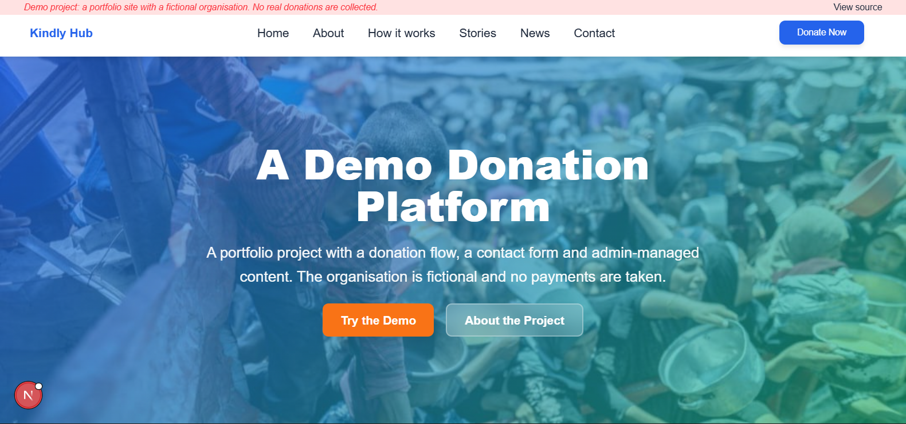

# Kindly Hub

A demo donation website built with Next.js and TypeScript.

> **This is a portfolio project.** The organisation, its mission and its content are fictional. No payments are taken and donation details are not stored.

**Live site:** <https://kindly-hub.vercel.app>



## What works

- **Donation form:** validates the amount, frequency, name and email with Zod, then shows a demo confirmation. No payment is taken.
- **Contact form:** validated in the browser and again on the server, then sent by email through Resend using an HTML template. User input is escaped in the template.
- **News and sample feedback:** read from Appwrite and managed in a separate admin dashboard ([kindly-hub-admin](https://github.com/T-tech26/kindly-hub-admin)).
- **Fallback content:** if Appwrite is unavailable, the site shows built-in sample updates and feedback.
- **Responsive layout** with a slide-in mobile menu.
- **Demo notice page** explaining what the site does and does not do.

## Tech stack

Next.js 16, React 19, TypeScript, Tailwind CSS 4, Appwrite (`node-appwrite`), Resend, Zod, Handlebars, date-fns, Sonner.

## Run it locally

Requires Node.js 20.9 or newer.

```bash
git clone https://github.com/T-tech26/kindly-hub.git
cd kindly-hub
npm install
cp .env.example .env.local
npm run dev
```

Fill in `.env.local` with your own values. The variable names are in `.env.example`:

| Variable | Used for |
| --- | --- |
| `NEXT_PUBLIC_APPWRITE_PUBLIC_URL`, `NEXT_PUBLIC_APPWRITE_PROJECT_ID`, `NEXT_PUBLIC_APPWRITE_IMAGE_BUCKET_ID` | Appwrite connection details that are safe to expose to the browser |
| `APPWRITE_API_SECRET_KEY` | Server-side Appwrite access (read-only scopes) |
| `APPWRITE_DATABASE_ID`, `APPWRITE_NEWS_COLLECTION_ID`, `APPWRITE_SUCCESS_STORY_COLLECTION_ID` | Which database and collections to read |
| `RESEND_API_KEY` | Sending contact form emails |
| `CONTACT_TO_EMAIL` | Where contact messages are delivered |

## Project structure

```
src/
  app/          Routes and layouts
  components/   Page sections and UI components
  config/       Appwrite configuration
  context/      Layout and data providers
  data/         Built-in fallback news and feedback
  lib/          Server actions, Appwrite client, email template
  types/        Shared type declarations
```

## Design decisions

- **Appwrite calls go through server actions.** The API key and database IDs stay on the server, and all data access lives in one place, separate from browser code.
- **The validation schema is shared between the browser and the server.** Server actions are public endpoints, so someone can skip the browser form and call one directly. The server re-checks the shape and size of the data and rejects anything invalid. HTML in user input is escaped in the email template.
- **Fallback content exists because of Appwrite's free plan.** Projects can be paused after inactivity, so when the fetch returns nothing the site shows built-in sample content instead of blank sections.

## Known limitations

- **No real payments.** The donation form is a demo.
- **Contact emails go only to the owner.** The form uses Resend's test sender, so messages are delivered only to the project owner's inbox.
- **Appwrite free plan.** The project can be paused after a period of inactivity. When that happens the site shows the built-in fallback content.
- **Content loads in the browser** after the page renders, so sections can be briefly empty.
- **No rate limiting** on the contact form.
- **No automated tests.**

## Possible next steps

- Fetch news on the server so it appears in the first page load.
- Add rate limiting to the contact form.
- Add tests for the validation schemas and server actions.
- Add a payment provider in test mode.

## Contact

[Portfolio](https://my-portfolio-rosy-theta-54.vercel.app/) · [GitHub](https://github.com/T-tech26)